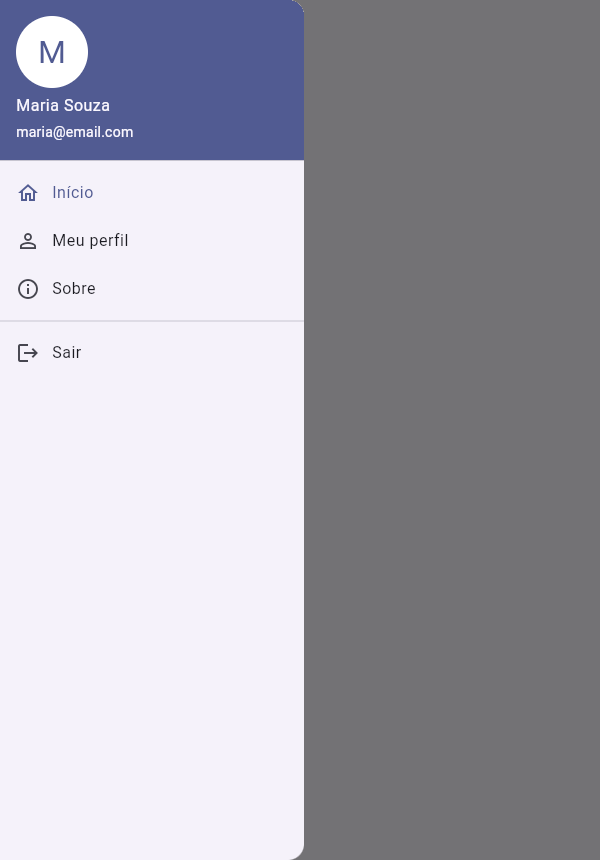
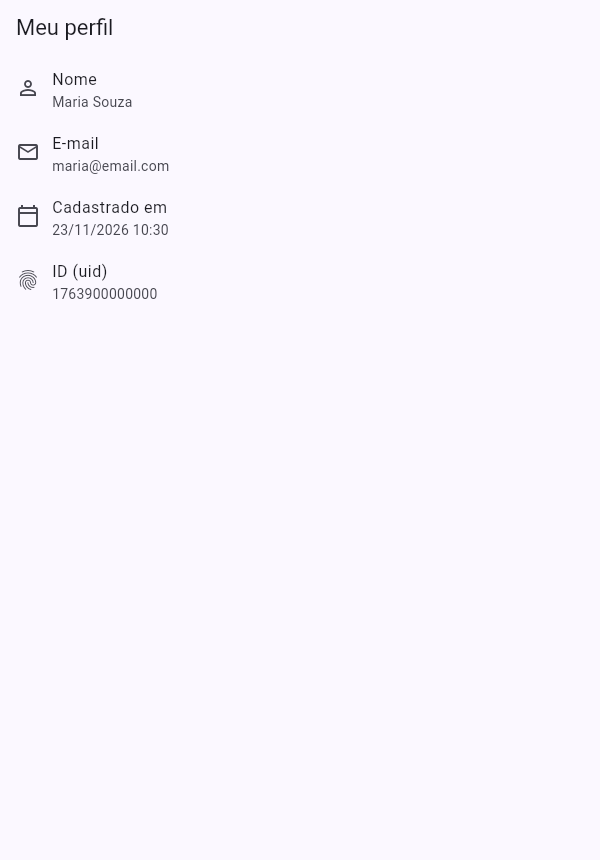

# App Cadastro (Flutter)

Aplicativo com cadastro e login de usuários, construído por etapas.

**Aluno:** Felipe Coronato — RA 60300641

## Como rodar

```bash
flutter pub get
flutter run
```

Testes automáticos:

```bash
flutter test
```

## Estrutura

```
lib/
├── main.dart                 # MaterialApp, tema e rotas
├── models/usuario.dart       # modelo do usuário (campos do Firebase User)
├── services/
│   ├── auth_service.dart     # cadastro, login e logout (mesmos nomes do FirebaseAuth)
│   └── auth_exception.dart   # erros com os códigos do Firebase
├── screens/                  # login, cadastro, home (em branco) e perfil
├── utils/validadores.dart    # validação dos campos
└── widgets/
    ├── campo_senha.dart      # campo de senha com mostrar/esconder
    └── menu_lateral.dart     # drawer da tela principal
wiki/                         # páginas da Wiki (histórias de usuário)
```

---

## Etapa 0 — Organização do projeto

**O que foi feito**
- Repositório criado no GitHub.
- README.md como única documentação; cada etapa ganha uma seção aqui.
- Uma tag por etapa (`etapa-1`, `etapa-2`, ...).

---

## Etapa 1 — Base do projeto, login e cadastro

Tag: `etapa-1`

**O que foi feito**
- Projeto Flutter criado (`flutter create`).
- Tela de **login** (e-mail e senha) e tela de **cadastro** (nome, e-mail, senha e confirmar senha).
- Validação dos campos: obrigatórios, formato do e-mail, senha com no mínimo 6 caracteres (regra do Firebase) e confirmação de senha.
- `AuthService` com os mesmos nomes de métodos do Firebase Auth
  (`createUserWithEmailAndPassword`, `signInWithEmailAndPassword`, `signOut`, `currentUser`)
  e erros com os mesmos códigos (`email-already-in-use`, `user-not-found`, `wrong-password`...).
  Nesta etapa os dados ficam só na memória.
- Requisitos levantados como histórias de usuário na Wiki
  (cópia em [`wiki/Historias-de-Usuario.md`](wiki/Historias-de-Usuario.md)).
- Testes em `test/widget_test.dart`.

**Prints**

| Login | Cadastro |
|---|---|
|  |  |

**Vídeo:** LINK DO YOUTUBE (não listado)

**Declaração de uso de IA**

- **Usei IA?** Sim. Usei o **Claude** (Claude Code, da Anthropic).
- **Para quê?** Passei o enunciado das etapas e a IA gerou o projeto da Etapa 1: o código das telas, o `AuthService`, os validadores, os testes, as histórias de usuário da wiki, este README, os prints das telas e os commits e a tag no Git.
- **O que ela sugeriu?**
  - Imitar o Firebase Auth: os mesmos nomes de método (`createUserWithEmailAndPassword`, `signInWithEmailAndPassword`, `signOut`, `currentUser`) e os mesmos códigos de erro (`email-already-in-use`, `wrong-password`...). Assim, quando o Firebase for ligado de verdade, só o `AuthService` muda.
  - Senha com no mínimo 6 caracteres, que é a regra do Firebase.
  - Um widget `CampoSenha` reaproveitável, com o botão de mostrar/esconder a senha.
  - Depois do cadastro, voltar para o login com o e-mail já preenchido.
- **O que mudou durante o desenvolvimento:**
  - Um teste automático achou um erro: `Navigator.pushNamed<String>` não funciona com as rotas do `routes:` do `MaterialApp`, porque elas são do tipo `dynamic`. A correção foi usar `pushNamed` sem tipo e conferir o resultado com `is String`.
  - O primeiro commit falhou porque o caminho de um arquivo passava do limite de tamanho do Windows. Foi resolvido com `git config core.longpaths true`.
  - Pedi as explicações em português e escolhi publicar o repositório como público.

---

## Etapa 2 — SharedPreferences e drawer

Tag: `etapa-2`

**O que foi feito**
- Pacote [`shared_preferences`](https://pub.dev/packages/shared_preferences) para salvar o usuário no aparelho.
  - O `Usuario` virou JSON (`toMap` / `fromMap`) e é salvo na chave `usuario`.
  - Só existe **um cadastro por vez**: salvar na mesma chave substitui o cadastro anterior.
  - A senha **não** é salva em texto puro: salvamos o hash SHA-256 (pacote `crypto`) e, no login, comparamos os hashes.
  - A chave `logado` guarda se a sessão está aberta. Ao abrir o app, o `main()` chama `AuthService.instance.carregarSessao()` e decide se abre no login ou na tela principal.
- Só a parte de dentro do `AuthService` mudou; as telas continuaram chamando os mesmos métodos no estilo Firebase.
- **Drawer** (`widgets/menu_lateral.dart`) com nome e e-mail do usuário no topo e as opções Início, Meu perfil, Sobre e Sair (com confirmação).
- **Tela principal em branco** (`screens/home_screen.dart`).
- Tela **Meu perfil** mostrando os dados salvos.
- Novas histórias de usuário na Wiki (HU05 a HU08).
- Testes do `AuthService` com `SharedPreferences.setMockInitialValues` (`test/auth_service_test.dart`).

**Prints**

| Tela principal | Drawer | Meu perfil |
|---|---|---|
|  |  |  |

**Vídeo:** LINK DO YOUTUBE (não listado)

**Declaração de uso de IA**

- **Usei IA?** Sim. Usei o **Claude** (Claude Code, da Anthropic).
- **Para quê?** A IA gerou o código da Etapa 2 a partir do enunciado: o salvamento com `shared_preferences`, o drawer, a tela principal, a tela de perfil, os testes, a documentação, os prints e os commits. Também criou o repositório no GitHub e enviou o projeto.
- **O que ela sugeriu?**
  - Salvar o usuário como JSON numa única chave (`usuario`). Salvar de novo na mesma chave sobrescreve o valor antigo, e é isso que faz o novo cadastro substituir o anterior, como o enunciado pede.
  - **Não salvar a senha em texto puro:** guardar o hash SHA-256 (pacote `crypto`) e, no login, comparar os hashes.
  - Guardar se o usuário está logado (chave `logado`), para o app abrir direto na tela principal enquanto ele não sair da conta.
  - Uma tela "Meu perfil" para mostrar que os dados ficaram salvos, já que a tela principal precisa ficar em branco.
  - Usar `pushReplacementNamed` no login e `pushNamedAndRemoveUntil` no logout, para o botão "voltar" não levar para uma tela errada.
- **O que mudou durante o desenvolvimento:**
  - Nas telas, só a navegação do login mudou (antes mostrava uma mensagem; agora abre a tela principal). O resto da mudança ficou dentro do `AuthService`. Isso mostrou a vantagem de ter separado o serviço das telas na Etapa 1.
  - Para tirar os prints com os dados salvos, os dados foram gravados direto no `localStorage` do navegador. Isso mostrou que, na versão web, o `shared_preferences` salva no `localStorage`.
