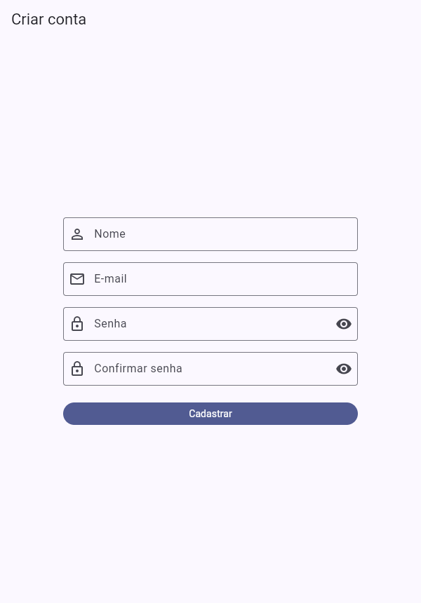

# App Cadastro (Flutter)

Aplicativo com cadastro e login de usuários, construído por etapas.

**Dupla:** NOME DO ALUNO 1 · NOME DO ALUNO 2

## Como rodar

```bash
flutter pub get
flutter run
```

Testes automáticos:

```bash
flutter test
```

## Estrutura

```
lib/
├── main.dart                 # MaterialApp, tema e rotas
├── models/usuario.dart       # modelo do usuário (campos do Firebase User)
├── services/
│   ├── auth_service.dart     # cadastro, login e logout (mesmos nomes do FirebaseAuth)
│   └── auth_exception.dart   # erros com os códigos do Firebase
├── screens/                  # telas
├── utils/validadores.dart    # validação dos campos
└── widgets/campo_senha.dart  # campo de senha com mostrar/esconder
wiki/                         # páginas da Wiki (histórias de usuário)
```

---

## Etapa 0 — Organização do projeto

**O que foi feito**
- Repositório criado no GitHub.
- README.md como única documentação; cada etapa ganha uma seção aqui.
- Uma tag por etapa (`etapa-1`, `etapa-2`, ...).

---

## Etapa 1 — Base do projeto, login e cadastro

Tag: `etapa-1`

**O que foi feito**
- Projeto Flutter criado (`flutter create`).
- Tela de **login** (e-mail e senha) e tela de **cadastro** (nome, e-mail, senha e confirmar senha).
- Validação dos campos: obrigatórios, formato do e-mail, senha com no mínimo 6 caracteres (regra do Firebase) e confirmação de senha.
- `AuthService` com os mesmos nomes de métodos do Firebase Auth
  (`createUserWithEmailAndPassword`, `signInWithEmailAndPassword`, `signOut`, `currentUser`)
  e erros com os mesmos códigos (`email-already-in-use`, `user-not-found`, `wrong-password`...).
  Nesta etapa os dados ficam só na memória.
- Requisitos levantados como histórias de usuário na Wiki
  (cópia em [`wiki/Historias-de-Usuario.md`](wiki/Historias-de-Usuario.md)).
- Testes em `test/widget_test.dart`.

**Prints**

| Login | Cadastro |
|---|---|
|  |  |

**Vídeo:** LINK DO YOUTUBE (não listado)

**Declaração de uso de IA**

> PREENCHER COM AS PALAVRAS DA DUPLA. Exemplo do que responder:
> - Usamos IA? Qual? (ex.: Claude)
> - Para quê? (ex.: gerar a estrutura inicial das telas, entender o `Form` e os validators)
> - O que ela sugeriu? (ex.: imitar os nomes de métodos do `FirebaseAuth`; um widget `CampoSenha` reaproveitável)
> - O que nós alteramos ou aprendemos? (ex.: o erro do `pushNamed<String>` com rotas nomeadas e como corrigimos)
